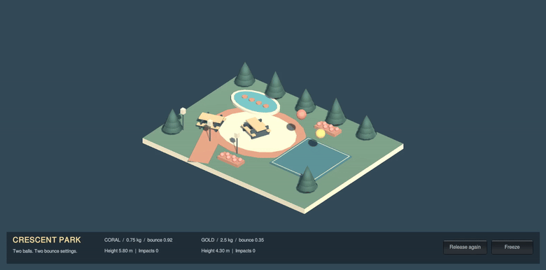
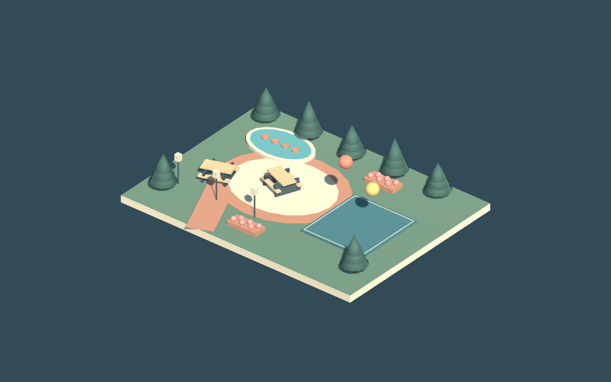

# Crescent Park — Unity Bouncing Game

A complete 3D park physics practical built in Unity 6. The scene features an oval plaza, a pond, picnic tables, cedar trees, flower beds, and a court with two bouncing Rigidbody spheres.

## Watch the game

**[Play the 12-second MP4 with video controls](http://shumail.me/bouncing-game/)** · [Download the original MP4](https://github.com/Shumail-AbdulRehman/bouncing-game/raw/refs/heads/main/CrescentPark-Working-Demo.mp4)

The recording has no audio. The animated preview above plays directly in this README; the linked GitHub Pages player provides MP4 playback, replay, and fullscreen controls.

## Open in Unity

1. Clone this repository or download the ZIP.
2. Add `AlternateVersion/CrescentPark` to Unity Hub.
3. Open with Unity **6000.6.1f1**.
4. Open `Assets/Scenes/ParkPhysicsEnvironment.unity` and press **Play**.
5. Click **Release again** to restart the drop; use **Freeze** to inspect it.

## Code and project files

- [Scene generator and physics validation](AlternateVersion/CrescentPark/Assets/Editor/CrescentParkFactory.cs)
- [Ball reset and collision tracking](AlternateVersion/CrescentPark/Assets/Scripts/DropExperiment.cs)
- [Runtime controls and live measurements](AlternateVersion/CrescentPark/Assets/Scripts/ExperimentPanel.cs)
- [Saved Unity scene](AlternateVersion/CrescentPark/Assets/Scenes/ParkPhysicsEnvironment.unity)
- [Full project instructions and assignment checklist](AlternateVersion/CrescentPark/README.md)
- [Complete project ZIP](CrescentPark-Complete-Unity-Project.zip)

## Physics

| Ball | Mass | Bounciness | Bounce Combine |
| --- | --- | --- | --- |
| Coral | 0.75 kg | 0.92 | Maximum |
| Gold | 2.5 kg | 0.35 | Maximum |

Both spheres have gravity enabled, Sphere Colliders, and continuous dynamic collision detection. The court has a Box Collider and the ground Plane has a Mesh Collider. Unity physics supplies the bounce, without scripted bounce forces.

Both balls rebounded and stayed above the collision surfaces during a 12-second Unity simulation. [Validation report](AlternateVersion/CrescentPark/Evidence/PhysicsValidation.txt).

Unity regenerates its Library, Temp, Logs, and UserSettings folders when opened; these are excluded from Git.
